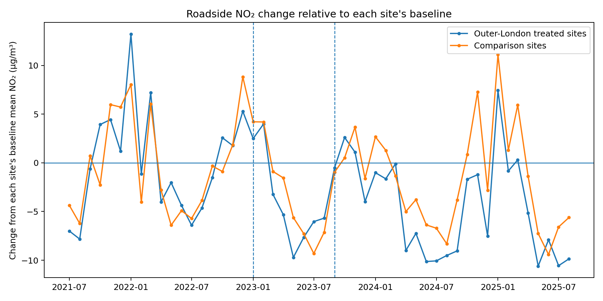
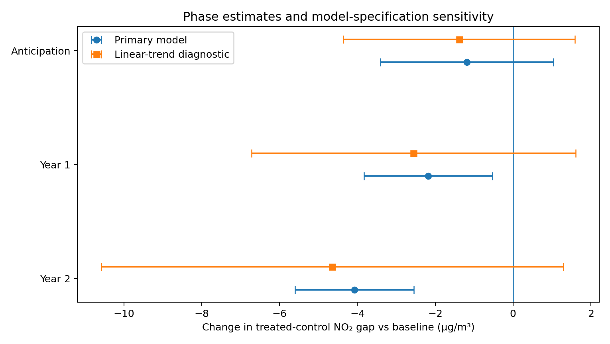

# Rapid Analysis 02: Outer London ULEZ and Roadside NO₂

**Analysis date: 2 October 2026**

[View the published analysis](https://jsklair.github.io/rapid_analysis_02_london_ulez_no2/)

London expanded the **Ultra Low Emission Zone (ULEZ)** across almost all Greater London on 29 August 2023. This rapid analysis asks a narrower question than whether the policy "worked":

> **What evidence is there that the August 2023 London-wide ULEZ expansion produced an additional reduction in roadside nitrogen dioxide (NO₂) in newly covered outer London, relative to comparable areas outside London, and did that difference persist into the scheme's second year?**

The analysis compares two long-running outer-London roadside monitors with three screened non-London traffic sites. It separates the earlier baseline, an anticipation period before formal enforcement, the first operational year and the second operational year.

## Terms used in this analysis

- **ULEZ** is London's Ultra Low Emission Zone. Vehicles that do not meet the emissions standards must pay a daily charge to drive within the zone, subject to exemptions.
- **NO₂** is nitrogen dioxide, a pollutant strongly associated with road traffic in urban areas.
- **LAQN** is the London Air Quality Network, operated by Imperial College London's Environmental Research Group.
- **AURN** is the UK Automatic Urban and Rural Network, managed for the Department for Environment, Food & Rural Affairs (Defra).
- **Comparison sites** are non-London roadside or urban-traffic monitors used to estimate how NO₂ might have changed without the London-wide expansion.
- **HAC uncertainty** means the regression standard errors allow for changing variance and short-run correlation over time.

## Key findings

### 1. The treated and comparison series had no detectable differential linear trend during the baseline

The final baseline covers **July 2021 to December 2022**.

After centring each monitoring site on its own baseline mean, the treated-minus-control gap had an estimated baseline slope of approximately **0.001 µg/m³ per month**. The 95% confidence interval was about **-0.19 to +0.19 µg/m³ per month**.

That is consistent with similar baseline movement in the final panel. It is a useful diagnostic, not proof that the counterfactual is correct.

### 2. The preferred model shows a larger relative NO₂ improvement after the expansion

Compared with the baseline treated-control gap, the preferred model estimates that roadside NO₂ in the two outer-London treated sites was lower relative to the three comparison sites by approximately:

| Period | Relative change | 95% confidence interval |
|---|---:|---:|
| Anticipation, Jan-Aug 2023 | -1.19 µg/m³ | -3.41 to +1.04 |
| Operational year 1, Sep 2023-Aug 2024 | **-2.18 µg/m³** | **-3.83 to -0.53** |
| Operational year 2, Sep 2024-Aug 2025 | **-4.07 µg/m³** | **-5.60 to -2.55** |

The two treated sites averaged about **26.2 µg/m³** during the baseline. The year-one and year-two estimates are therefore roughly equivalent to **8% and 16% of that treated-site baseline level**, respectively. Those percentages are an aid to scale, not a directly comparable estimate to other ULEZ evaluations.

Year 2 was also estimated to be **1.89 µg/m³ lower than year 1** in the primary model, with a 95% confidence interval of roughly -3.46 to -0.33 µg/m³.

### 3. The direction is fairly stable, but the causal interpretation is model-sensitive

The year-two estimate remains negative when each control is removed in turn and when Bromley Harwood Avenue is added as a treated-site sensitivity check.

However, an alternative specification that explicitly carries a separate linear treated-control trend through the whole study period produces much wider uncertainty. A calendar-month fixed-effect version of that trend model gives a different magnitude again.

That sensitivity matters. The analysis supports evidence of a **relative improvement in roadside NO₂ in this screened outer-London panel, particularly by the second operational year**. It does not establish that the entire difference was caused by the ULEZ expansion.

## Method

### Treatment and periods

The London-wide ULEZ expansion came into force on **29 August 2023**.

The analysis uses four periods:

- **Baseline:** July 2021 to December 2022
- **Anticipation:** January to August 2023
- **Operational year 1:** September 2023 to August 2024
- **Operational year 2:** September 2024 to August 2025

The anticipation period is separated because vehicle replacement, publicity, scrappage support and rising compliance began before formal enforcement.

### Monitoring sites

Primary treated sites:

- Havering - Rainham (HV1)
- Havering - Romford (HV3)

Primary comparison sites:

- Leicester A594 Roadside (LEIR)
- Doncaster A630 Cleveland Street (DCST)
- Blackburn Accrington Road (BLAR)

Monitoring sites had to pass a pre-declared data-completeness rule and a separate screen for material local transport interventions.

Bromley - Harwood Avenue (BY7) failed the primary coverage rule because only 10 of 12 months were valid in operational year 1. It is retained only as a sensitivity check.

The full inclusion and exclusion audit is in [`data/site_selection.csv`](data/site_selection.csv).

### Data-quality rule

A site-month is valid only if at least **75% of the expected hourly NO₂ observations** are present.

No missing monthly pollution values are imputed.

For primary inclusion, a site also had to meet minimum valid-month counts in the baseline, anticipation period and both operational years.

### Primary model

Each retained site's monthly NO₂ is first expressed as a change from that site's own valid baseline mean. The two treated-site changes and three control-site changes are then averaged separately.

The principal outcome is:

**average treated-site change minus average comparison-site change**

The primary regression estimates separate anticipation, year-one and year-two shifts in this monthly gap, with a simple annual seasonal cycle. Standard errors use a **heteroscedasticity-and-autocorrelation-consistent (HAC)** estimator with three monthly lags.

This is best read as a **comparative interrupted time-series analysis** rather than a textbook difference-in-differences study.

## Robustness and limitations

The main checks are:

- calendar-month fixed effects instead of the annual sine/cosine seasonal terms;
- a model carrying an explicit differential linear time trend;
- a stricter 43-month complete-case panel;
- dropping each control site in turn;
- adding Bromley Harwood Avenue as a treated-site sensitivity check.

The no-linear-trend specifications give very similar year-one and year-two estimates. The explicit trend specifications are more unstable. This is the main reason for restrained causal wording.

Other limitations matter:

- the final panel contains only two treated and three primary comparison sites;
- comparison-site selection requires judgement, even though it was screened before the ULEZ effect was estimated;
- the analysis does not explicitly weather-normalise the pollution series;
- national vehicle-fleet turnover and other transport policies could affect treated and control locations differently;
- the analysis concerns roadside NO₂ only, not health outcomes, particulate pollution or the overall benefits and costs of ULEZ;
- the expansion is treated as a policy package, not as an isolated estimate of the £12.50 daily charge.

## How this relates to other ULEZ evidence

The Greater London Authority's March 2025 one-year report estimated that outer-London roadside NO₂ was **up to 4.8% lower** in the first operational year than under its modelled no-expansion scenario.

A 2025 peer-reviewed study using weather normalisation and an augmented synthetic-control method found **no statistically detectable NO₂ effect** from the 2023 expansion over a study period ending on 30 April 2024.

Those results are not directly interchangeable with this analysis. They use different monitoring-site sets, counterfactual methods, weather treatment and post-expansion windows. RA02 is deliberately smaller and extends through August 2025, so its main contribution is the second-year comparison rather than an attempt to supersede either study.

## Reproducibility

The repository preserves the processed monthly snapshot used for the published analysis, plus the scripts needed to refresh it from the official monitoring networks.

Normal rerun sequence:

1. `python -m pip install -r requirements.txt`
2. `python python/01_prepare_air_quality_data.py`
3. `python python/02_analyse_ulez_no2.py`

Running the preparation script later is a **data refresh**, because the live monitoring networks may revise or ratify observations. The retained `data/processed/monthly_panel.csv` and its SHA-256 checksum in `source_metadata.json` identify the snapshot behind the published results.

## Sources

Primary monitoring data:

- London Air Quality Network, Imperial College London Environmental Research Group
- Defra UK-AIR Automatic Urban and Rural Network

Context and comparison:

- Greater London Authority, *London-wide Ultra Low Emission Zone One Year Report*, 7 March 2025
- Greater London Authority EIR response on second-year air-quality analysis, 15 August 2025
- *npj Clean Air*, 2025, *Further improvement in London's air quality demands more than the Ultra Low Emission Zone policy*

Full links and site-screening notes are in [`data_sources.md`](data_sources.md).
