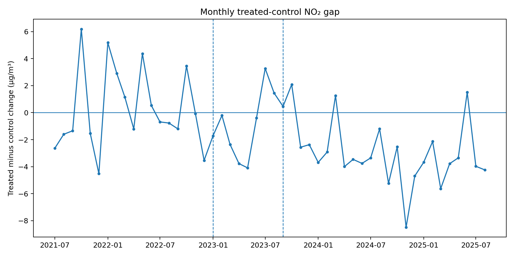

# Outer London ULEZ and Roadside NO₂

**Rapid analysis: 2 October 2026**

London expanded the **Ultra Low Emission Zone (ULEZ)** across almost all Greater London on 29 August 2023.

This analysis asks:

> **What evidence is there that the expansion produced an additional reduction in roadside nitrogen dioxide (NO₂) in newly covered outer London, relative to comparable areas outside London, and did that difference persist into the second year?**

## Reading the analysis

- **NO₂** is nitrogen dioxide, an air pollutant strongly associated with road traffic in urban areas.
- The **treated sites** are two long-running roadside monitors in outer London: Rainham and Romford.
- The **comparison sites** are three screened non-London traffic monitors in Leicester, Doncaster and Blackburn.
- Each site's monthly NO₂ is measured relative to its own July 2021 to December 2022 baseline.
- Negative treated-control values mean the outer-London sites improved more than the comparison sites.

## The baseline check

Before the 2023 expansion, the final treated-control gap showed no detectable differential linear trend.

The estimated baseline slope difference was approximately **0.001 µg/m³ per month**, with a 95% confidence interval spanning roughly -0.19 to +0.19.

That does not prove the counterfactual is correct, but it is a necessary check before interpreting the post-expansion comparison.

## What changed after the expansion?

The preferred model estimates that the outer-London roadside sites improved relative to the comparison sites by approximately:

- **2.18 µg/m³ in operational year 1** (September 2023 to August 2024);
- **4.07 µg/m³ in operational year 2** (September 2024 to August 2025).

The treated sites averaged about **26.2 µg/m³** during the baseline, so those estimates are roughly equivalent to 8% and 16% of the treated-site baseline level.

The relative improvement was larger in year 2 than year 1. The primary model estimates the additional year-two change at about **-1.89 µg/m³**.

## Why the conclusion remains cautious

The direction of the result is fairly stable across the main seasonal specifications, the stricter complete-case panel, leave-one-control-out checks and a Bromley sensitivity analysis.

The main uncertainty is how to treat a possible longer-run difference in trend between the London and non-London sites. Adding an explicit differential linear trend makes the estimates much less precise, and an alternative seasonal form gives a different trend-adjusted magnitude.

The evidence therefore supports a **relative improvement in roadside NO₂ in this small screened outer-London panel, particularly by the second operational year**.

It does **not** establish that the whole difference was caused by the ULEZ expansion.

## How the comparison was built

A site-month had to contain at least **75% of the expected hourly NO₂ observations**.

Sites were also screened for local road or transport interventions that could contaminate the comparison. For example, Nottingham Western Boulevard was excluded despite strong pre-period statistical fit because substantial corridor works overlapped 2023-2024.

No missing monthly NO₂ values were imputed.

The analysis separates:

- baseline: July 2021 to December 2022;
- anticipation: January to August 2023;
- operational year 1: September 2023 to August 2024;
- operational year 2: September 2024 to August 2025.

## How this fits with existing ULEZ evidence

The Greater London Authority's March 2025 one-year evaluation estimated outer-London roadside NO₂ to be up to **4.8% lower** than its modelled no-expansion scenario in the first year.

A 2025 peer-reviewed study using weather normalisation and an augmented synthetic-control method reported **no statistically detectable NO₂ effect** from the 2023 expansion over a study period ending in April 2024.

RA02 is not a replication of either. It uses a smaller screened panel and a simpler transparent comparative time-series design, but extends the observation window through August 2025.

## Important limitations

- Only two treated and three primary comparison sites are used.
- The analysis does not explicitly weather-normalise NO₂.
- Site selection still involves judgement, despite being screened before the policy effect was estimated.
- National fleet turnover and other transport changes may differ between London and the comparison cities.
- The result concerns roadside NO₂ only.
- The expansion is treated as a broader policy package, not as an isolated estimate of the daily charge.

## Technical details

The analysis is reproducible in Python using pandas, NumPy, Matplotlib and statsmodels.

[View the full repository](https://github.com/jsklair/rapid_analysis_02_london_ulez_no2)

[Read the detailed README](https://github.com/jsklair/rapid_analysis_02_london_ulez_no2#readme)
